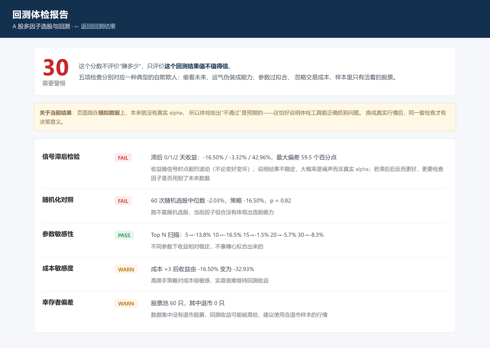
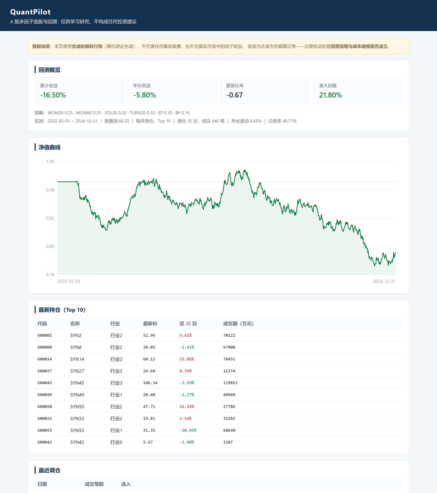

# QuantPilot · A 股多因子选股与回测

[](https://github.com/myd31588-create/quantpilot/actions/workflows/ci.yml)
[](LICENSE)

> **仅供学习研究，不构成任何投资建议，不提供选股服务。**

用 Java 实现的多因子选股 + 事件驱动回测框架，**外加一个市面上没有的东西：回测体检**。



## 它和别的回测项目有什么不同

所有量化项目都在展示「我的策略年化多少」，但**没人能证明这个数字不是作弊来的**。

QuantPilot 的核心不是选股，是**审计**：给定一份回测结果，判断它值不值得信。

| 体检项 | 抓什么病 | 原理 |
|---|---|---|
| **信号滞后检验** | 前视偏差（偷看未来） | 把选股信号整体延后 1/2 天，结果应平滑变化；剧烈波动说明是噪声或用了未来数据 |
| **随机化对照** | 收益是不是运气 | 同股票池、同调仓频率，随机选股跑 60 次，看策略能否跑赢随机分布（p 值） |
| **参数敏感性** | 过拟合 | Top N 从 5 扫到 30，如果只有一档好、邻居全崩，就是拟合出来的 |
| **成本敏感度** | 靠零成本假设撑收益 | 成本 ×3 后收益还剩多少 |
| **幸存者偏差** | 样本里只有活着的股票 | 检查数据集中退市股票占比，为 0 直接标红 |

输出一个 **0–100 的可信度评分** + 逐项红黄绿灯 + 人话解释。

> 截图里的策略跑在模拟数据上，本来就没有 alpha，所以体检给出 **30 分 / 不通过** ——
> 这恰好说明体检能正确抓到问题。换成真实行情后，同一套检查才有决策意义。



## 为什么不是 Python

量化圈默认 Python，这个项目刻意用 Java，原因是**约束不同**：

- A 股 5000 只 × 10 年日线 ≈ 1200 万行，Java 完全够用，用不上 pandas
- 想练的是工程能力：并发、缓存、调度、接口设计
- 与个人技术栈一致

**工具选型看约束，不看流行度。**

## 快速开始

要求：JDK 17+

```bash
mvn spring-boot:run
```

打开 <http://localhost:8090>。默认使用**合成的模拟行情**，不联网、不依赖任何外部服务。

> 页面上的收益为正为负都属正常：模拟数据里没有真实 alpha，
> 这里验证的是**回测流程和成本建模是否成立**，不是策略能不能赚钱。

## 它做了什么

```
模拟/真实行情
   → 因子计算（6 个：动量 20/60、波动率、换手率、EP、BP）
   → 截面标准化（MAD 去极值 + Z-score）
   → 过滤（ST、上市不足 60 天、成交额过低、停牌）
   → 加权打分取 Top 10
   → 每月调仓，按次日开盘价成交
   → 扣佣金 / 印花税 / 滑点，处理涨跌停与停牌
   → 净值曲线 + 指标
```

## 三个关键设计

### 1. 前视偏差靠结构避免

```java
public BarSeries asOf(LocalDate asOf)   // 唯一的数据入口
```

因子函数拿到的序列**物理上取不到未来数据**。测试里追加了 5 根价格翻 10 倍的"未来"K 线，
验证同一天的因子值完全不变。

### 2. 过滤必须在打分之前

先打分再过滤，一只停牌股的极端因子值会把整个截面的均值和标准差带偏。顺序错了结果就是错的。

### 3. 交易规则按 A 股实际来

| 规则 | 实现 |
|---|---|
| 最小交易单位 | 100 股一手，向下取整 |
| 涨停买不进 / 跌停卖不出 | 用前收盘价判断开盘是否触板 |
| 停牌不可交易 | 当天无 bar 则不成交 |
| 交易成本 | 佣金万 2.5（最低 5 元）+ 印花税千 1（卖出）+ 滑点 0.1% |

## 测试

```bash
mvn test
```

覆盖：前视偏差、涨跌停、停牌、成本影响、净值与调仓次数。

## 目录

```
src/main/java/com/quantpilot/
├── domain/     Bar / BarSeries / MarketData / StockInfo
├── data/       数据源接口 + 合成数据实现
├── factor/     因子定义、计算与标准化
├── strategy/   选股（过滤 → 打分 → TopN）
├── backtest/   回测引擎、成本模型、指标
└── web/        页面与接口（SVG 图表，无 CDN 依赖）
```

## 路线图

- [x] v0.1 合成数据 + 因子 + 选股 + 回测 + 页面
- [x] v0.2 回测体检（信号滞后 / 随机对照 / 参数敏感 / 成本敏感 / 幸存者）
- [ ] v0.3 接入真实数据（akshare 脚本 + CSV 读取）
- [ ] v0.4 基准对比（沪深 300）、行业中性化
- [ ] v0.5 体检报告导出 PDF / 参数扫描热力图

## 合规

- 本项目**不提供**任何荐股、代客理财、收益承诺服务
- 行情数据不随仓库分发，需自行获取
- 仓库内所有数据均为程序生成的模拟数据

## License

Apache-2.0
